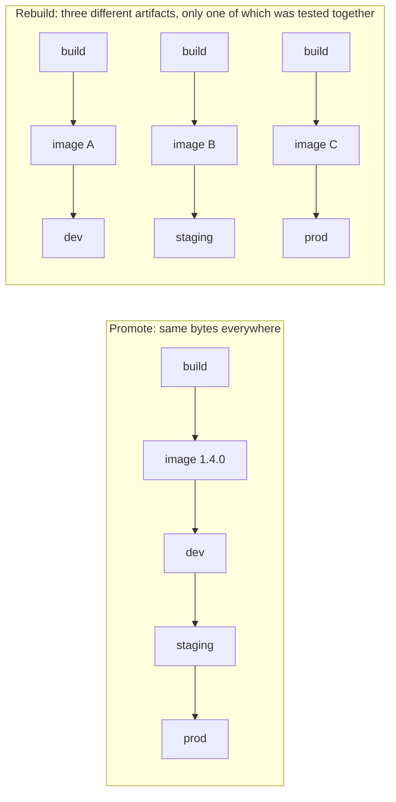

# Build Once, Promote Many

The delivery half of CI/CD rests on one rule: build the thing you ship once, then move that same thing through each environment. This page explains why, and what has to be true of your artifact and configuration for it to work. The pipeline that does it is [Promote, Don't Rebuild](../pipelines/promote-across-environments.md).

## Artifacts

An **artifact** is the output of a build that gets deployed or published: a container image, a zip for a serverless function, a `.jar`, a mobile app bundle, a folder of static files. It is the unit that moves between environments.

The artifact should be the only thing that comes from your build. Environments receive artifacts; they never receive source code to build themselves.

## Immutable versions

Each artifact needs a version that names it exactly and never changes meaning. `my-service:1.4.0-12-g3f2a9c1` should be the same bytes today, next week, and when someone rolls back to it in a year.

- Derive the version from Git, so you can always trace an artifact back to its commit. See [`gitVersion`](../library/git-version.md).
- Don't reuse tags. A moving tag such as `latest` or `staging` says where something is, not what it is, and an approval for "latest" approves whatever happens to be there later.
- Turn on tag immutability in the registry where it exists, so a pushed tag can't be overwritten.
- For container images, the digest (`sha256:…`) is the true identity. A tag is a readable pointer to it.

## Environments

An **environment** (also called a deploy target or stage) is a running copy of your system. A typical set:

| Environment | Purpose | Deployed |
| --- | --- | --- |
| dev | first real run, integration with other services | automatically from `main` |
| staging | production-like, final checks, demos | after an approval |
| prod | real users | after an approval |

Environments are often in separate cloud accounts, so a mistake in dev can't touch prod. Don't confuse an environment with an environment variable; the [Glossary](glossary.md) has both.

## Promotion versus rebuild

**Promotion** means taking the artifact that passed one environment and deploying the same artifact to the next. **Rebuilding** means checking out the same commit and building again for each environment.

Rebuilding looks equivalent but isn't. Between two builds a base image tag can move, a dependency range can resolve to a newer package, a build tool can update. The result is a prod artifact that never ran in dev or staging, whose security scan was done on a different artifact, and whose bugs nobody has seen yet.

Promotion is also faster, since deploying an existing artifact takes seconds to minutes and building can take much longer.

## Configuration per environment

If the same artifact runs everywhere, everything that differs between environments has to come from outside it. This is the "config" rule from the twelve-factor app approach: store configuration in the environment, not in the build.

- **Baked into the artifact**: code, dependencies, static assets, default settings that are the same everywhere.
- **Supplied at deploy or run time**: database URLs, API endpoints, feature flags, log levels, replica counts, and every secret.

Typical sources are environment variables set by the deploy (an ECS task definition, a Kubernetes manifest, a Lambda configuration), a parameter store or secrets manager, or a config file per environment kept in the deploy step rather than the image.

A sign this has gone wrong: a build parameter like `TARGET_ENV=prod` that changes what gets compiled. That produces a different artifact per environment, which is a rebuild under another name.

> [!NOTE]
> Static frontends are the common exception, because many frameworks inline settings at build time. Either load a small config file at startup from the hosting location, or accept one build per environment and treat each as its own artifact.

## Approvals

An approval is a pause before an environment where a person confirms the promotion. In Jenkins it is an `input` step; see [Parameters & Approval Gates](../fundamentals/parameters-and-approval-gates.md).

An approval only means something if the approver knows exactly what they are approving. With build-once, they approve a specific version that has already run in the environment before. With rebuilds, they approve an artifact that doesn't exist yet.

Good approvals:

- show the version and a link to what changed
- are restricted to the people allowed to release (`submitter`) and record who approved
- time out instead of waiting forever
- don't hold an executor while waiting

When several runs wait at the same gate, approving an older one after a newer one deploys the older version. The recipe uses the `milestone` step to prevent that. Day-to-day handling of approvals is in [Promotions](../guides/promotions.md).

## Rollback

With immutable artifacts, rollback is not a special operation. It is a deploy of an earlier version that already ran in that environment. You don't rebuild an old commit (that produces a new, untested artifact); you redeploy the old artifact.

That only works if old artifacts are still there. Keep enough history in the registry, and don't let a lifecycle rule delete the images prod might need to go back to. Database migrations need care too: a rollback is only safe if the old version still works with the current schema, which is why migrations are usually written to be backwards compatible for at least one release.

The steps are in [Roll Back a Deploy](../guides/roll-back-a-deploy.md).

## Related pages

- [Promote, Don't Rebuild](../pipelines/promote-across-environments.md): the full pipeline, with scan, approvals and cross-account deploys.
- [From Build to Deploy](../tutorials/build-to-deploy.md): a step-by-step walkthrough.
- [Secrets in CI](secrets-in-ci.md): how deploy credentials stay out of the artifact and the log.
- [Tag-Triggered Release](../pipelines/release.md): publishing versioned artifacts from tags.
