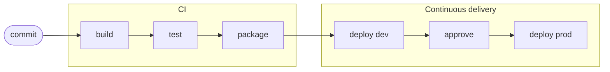

# CI/CD in One Page

The ideas behind every recipe in this cookbook, without any Jenkins syntax. If you know what a pipeline is for and why the `Jenkinsfile` lives in your repo, the rest of the cookbook reads as a set of answers to "how do I do that in Jenkins".

## Continuous integration

Continuous integration (CI) means everyone merges small changes into the main branch often, and every change is built and tested automatically before and after it lands. The goal is to find out within minutes that a change broke something, while the author still remembers what they did.

Without CI, people work on long-lived branches and merge rarely. Each merge then brings a pile of conflicts and surprises, and nobody knows which of the last forty commits broke the tests. With CI, the answer is usually "the one that just turned the build red".

CI is a habit as much as a tool. Jenkins can run the tests, but the benefit only comes if people merge often and fix a broken build straight away.

## Continuous delivery and continuous deployment

Both extend CI past testing, towards running software.

- **Continuous delivery**: every change that passes the pipeline produces a release candidate that could go to production at any time. A person decides when, usually by approving a step.
- **Continuous deployment**: every change that passes the pipeline goes to production automatically, with no manual step.

The difference is one approval. Most teams start with continuous delivery: automatic deploys to a dev environment, then a manual gate in front of production. Some later remove the gate once their tests and monitoring are good enough to trust. Both rely on the same thing: the pipeline, not a person's laptop, builds and ships the software.

## What a pipeline is

A pipeline is the ordered list of things that happen to a change on its way from a commit to a running system. Each step either adds confidence or stops the change.

The early stages are fast and run on every change. The later ones are slower, touch real environments and usually run only on `main`. A failure anywhere stops the run, so a change that fails its tests never reaches an environment.

In Jenkins, each box is usually a stage, and the whole thing is described in a `Jenkinsfile`. See [Pipeline Skeleton](../fundamentals/pipeline-skeleton.md) for that shape in code, and [How Jenkins Runs Your Pipeline](how-jenkins-runs-your-pipeline.md) for what happens when it runs.

## Why pipeline as code

The pipeline is defined in a file called `Jenkinsfile` at the root of your repository, rather than in forms on the Jenkins web UI. That gives you:

- **Review**: a change to the pipeline goes through a pull request like any other change. Someone else sees that you removed the test stage before it happens.
- **History**: `git log Jenkinsfile` shows who changed the build, when, and why. A form on a web page has no such history.
- **Branches**: a feature branch can change its own build (add a new test suite, say) without affecting `main` until it merges.
- **Reproducibility**: the pipeline for a given commit is the one in that commit. Building an old tag uses the pipeline as it was then.
- **Reuse**: common steps live in a shared library, so a fix to "how we push an image" reaches every repo. See [Shared Library Setup](../library/setup.md).

Treat the `Jenkinsfile` as production code. It decides what gets deployed and holds references to credentials, so it deserves the same review as the code it ships.

## Green main

"Green main" means the latest build of the `main` branch passed. It is the single most useful signal CI gives you, and it only stays useful if the team protects it.

When `main` is green:

- anyone can branch from it and know that a failure on their branch is theirs
- `main` can be released or deployed at any time
- a new failure points straight at the change that caused it

When `main` stays red, people stop looking. New failures hide behind the old one, people branch from broken code, and deploys either stop or go out untested.

Habits that keep it green:

- build and test every pull request before merge, and make the Git host require that check to pass; see [Branches, Pull Requests and What Runs Where](branches-and-pull-requests.md)
- if `main` goes red, fixing it (or reverting the change) comes before new work
- quarantine a flaky test rather than teaching people to ignore red builds; see [Retries & Error Handling](../fundamentals/retries-and-error-handling.md)

> [!TIP]
> Reverting is a perfectly good fix. Revert the change that broke `main`, get back to green, then fix the change properly on a branch.

## Where to go next

- [Your First Pipeline](../tutorials/first-pipeline.md) builds a small pipeline from scratch.
- [Build Once, Promote Many](build-once-promote-many.md) explains the delivery half: one artifact moving through environments.
- [Glossary](glossary.md) defines the Jenkins terms used across the cookbook.
