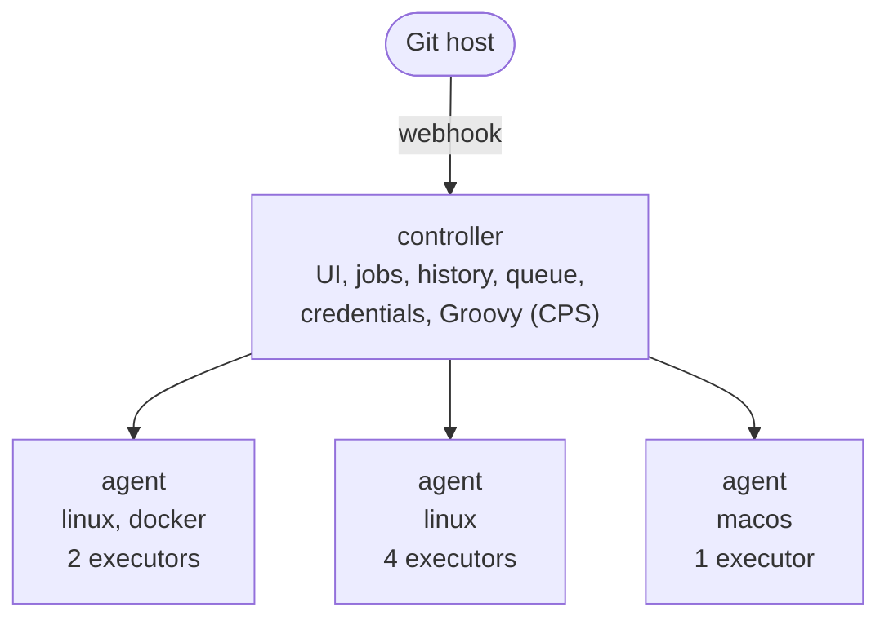
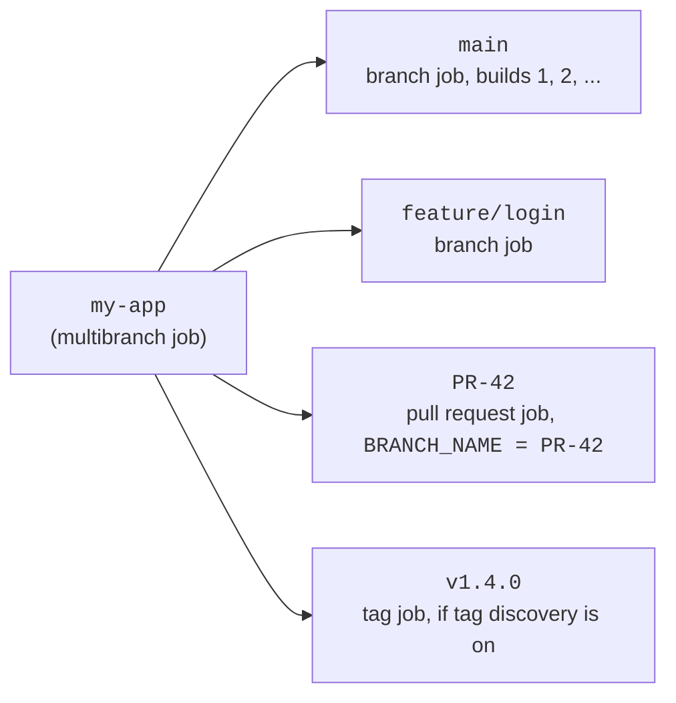

# How Jenkins Runs Your Pipeline

What actually happens between pushing a commit and seeing a green or red build. Most confusing Jenkins errors make sense once you know which machine a line of your `Jenkinsfile` runs on and which directory it runs in. Each section below ends with the errors it explains.

## Controller and agents

A Jenkins installation has one **controller** and usually several **agents**.

- The **controller** is the Jenkins server itself. It serves the web UI, stores job configuration and build history, keeps the credentials, schedules work and runs the Groovy that drives your pipeline.
- An **agent** is a machine (or container) that does the actual work: checking out code, compiling, running tests, building images. Agents connect to the controller and wait to be given work.

Your Jenkins administrator runs both. Agents differ in what they have installed: one might have Docker, another Xcode, another a JDK and Android SDK. That is why your pipeline has to say what kind of agent it needs.



A well-run controller has no executors of its own, so builds never run on it. Builds on the controller can read its files, including its secrets.

## Executors and labels

An **executor** is a slot on an agent that can run one piece of work at a time. An agent with four executors can run four stages from different builds at once.

A **label** is a tag the administrator puts on an agent, such as `linux`, `docker` or `macos`. Your `Jenkinsfile` asks for a label (or an expression like `linux && docker`) and Jenkins picks any agent that matches and has a free executor. You don't choose the machine; you describe what you need.

`agent any` means "any free executor anywhere". It works for examples, but in real pipelines it picks machines that may lack your tools. See [Agents & Labels](../fundamentals/agents-and-labels.md).

Errors this explains:

- `sh: npm: command not found` or a wrong tool version: the build landed on an agent without that tool. Ask for a label that guarantees it, or use a Docker agent with a pinned image.
- `There are no nodes with the label 'xyz'`: nothing matches the label. Check the spelling against the labels your administrator has configured.

## The queue

When a build or stage needs an executor, it goes into the **queue** until one matching its label is free. While it waits, the console log shows something like:

```text
Waiting for next available executor on 'linux'
```

That is not an error. It means every matching executor is busy, or every matching agent is offline. If it lasts more than a few minutes, look at the agent list (**Build Executor Status** on the Jenkins home page) to see which. Cloud agents that start on demand can take a minute or two to appear.

A run that holds an executor while it waits for something else, such as an approval, wastes a slot others are queueing for. That is why approval pipelines use `agent none` and per-stage agents. See [Parameters & Approval Gates](../fundamentals/parameters-and-approval-gates.md).

## Workspaces

A **workspace** is the directory on an agent where a job's files live during a build. It is per job, per agent: job `my-app` on agent `linux-1` has one workspace, and the same job on `linux-2` has a different one. If two builds of the same job run at once on one agent, the second gets a copy with a suffix such as `@2`.

Two consequences catch people out:

- **Workspaces are not shared between agents.** A stage on a different agent starts with a fresh checkout and none of the files the previous stage built. Pass files across with [Stash & Unstash](../fundamentals/stash-and-unstash.md), or archive them as artifacts.
- **Workspaces are reused between builds on the same agent.** Files from the last build (old build output, stale test reports, a leftover `node_modules`) may still be there. A build that only passes because of leftovers will fail on a fresh agent. `cleanWs()` in a `post { cleanup { … } }` block wipes the workspace at the end of every run; see [Post-Actions & Status Notifications](../fundamentals/post-actions-and-status-notifications.md).

Errors this explains:

- `Required context class hudson.FilePath is missing`: a step that needs a workspace ran where there is no agent, so there is no workspace. See [Troubleshooting](../guides/troubleshooting.md).
- `No such file or directory` for a file an earlier stage created: the stage ran on another agent. Stash it or use one agent for both stages.
- Tests that pass in Jenkins but fail locally (or the reverse) after a dependency change: leftover files in a reused workspace.

## Checkout

In a pipeline loaded from the repo, Jenkins checks out the commit being built into the workspace before your first stage runs. Inside steps, `checkout scm` means "the same repository and commit this build was started for". With `agent none` and per-stage agents, each stage that gets an agent checks out again into its own workspace, unless you turn that off with `skipDefaultCheckout()` and check out explicitly where you need it.

The checkout is of one exact commit, often detached from any branch. Tools that expect `git branch` to print a branch name may be confused; use `BRANCH_NAME` instead. See [Multibranch & Pull Requests](../fundamentals/multibranch-and-pull-requests.md).

## Where each line runs

This is the part that explains the strangest errors. Your `Jenkinsfile` is Groovy, and Groovy runs **on the controller**. Steps such as `sh`, `bat`, `readFile`, `writeFile` and `junit` are sent to the **agent** and run there, in the workspace.

```groovy
stage('Example') {
    agent {
        label 'linux'
    }
    steps {
        // runs on the agent, in the workspace
        sh 'make build'

        script {
            // this groovy runs on the controller
            def version = readFile('VERSION').trim()

            // readFile is a step, so it read the agent's file; plain groovy file access would read the controller's disk
            if (version.startsWith('0.')) {
                echo "Pre-release version ${version}"
            }
        }
    }
}
```

So `sh` sees the agent's tools, files and environment, while `if`, variables and string handling happen on the controller. Use steps for anything that touches files or runs commands.

The Groovy runs in a sandbox that only allows an approved list of methods, so a `Jenkinsfile` can't take over the controller. It also runs under CPS (continuation-passing style): Jenkins saves the state of your pipeline after every step so a build can survive a controller restart and carry on where it left off. That durability is why every variable alive across a step must be serializable, and why some ordinary Groovy (regex matchers, `JsonSlurper` results, some closures) behaves oddly or fails. Keep logic in `Jenkinsfile`s simple and move anything clever into steps or a shared library.

Errors this explains:

- `RejectedAccessException: Scripts not permitted to use`: the sandbox blocked a method.
- `NotSerializableException`: a non-serializable object was held across a step.
- `MissingPropertyException: No such property`: a name Groovy couldn't resolve, often a variable local to another `script` block.

All three are covered in [Troubleshooting](../guides/troubleshooting.md), and the CPS gotchas in [`Jenkinsfile` Tips](../fundamentals/tips.md).

## Stages and parallel

A **stage** is a named group of steps, shown as a column in the UI. Stages run in order, and a failure stops the stages after it (apart from `post` blocks, which always get a chance to run). Stages are mainly for people: a failed "Test" stage tells you more than a failed build.

`parallel` runs several stages at the same time, each on its own executor and usually its own agent, so they don't share a workspace. Use it for independent work such as unit tests and lint, or builds for different platforms. A pipeline with three parallel stages needs three free executors to get the full speed-up; with fewer, some branches wait in the queue. See [Parallel Execution](../fundamentals/parallel-execution.md) and [Matrix Builds](../fundamentals/matrix-builds.md).

## Builds, build numbers, artifacts and logs

Each run of a job is a **build**, numbered from 1 upwards per job. In a multibranch job each branch and pull request is its own job, so `main` and `PR-42` each have their own build #1. `BUILD_NUMBER` and `BUILD_URL` are available to every step.

A build keeps:

- the **console log**: everything the steps printed, the first place to look when something fails; see [Reading a Failed Build](../tutorials/reading-a-failed-build.md)
- **artifacts**: files saved with `archiveArtifacts`, downloadable from the build page after the workspace is gone
- **test results**: reports recorded with `junit`, shown as trends across builds

All of it lives on the controller, and old builds are deleted by the build discarder you set in [Options Defaults](../fundamentals/options-defaults.md). An artifact you need to keep for a release belongs in a registry or bucket, not only in Jenkins.

## What multibranch creates

A **Multibranch Pipeline** job points at a repository. It scans the repo (**branch indexing**) and creates a child job for every branch, pull request and, if enabled, tag that contains a `Jenkinsfile`. Each child has its own builds, history and workspaces, and each reads the `Jenkinsfile` from its own branch.



A webhook from the Git host tells Jenkins about pushes straight away; without one, new branches only appear on the next periodic scan. When a branch or PR goes away, its child job is removed according to the orphaned item strategy. See [Multibranch & Pull Requests](../fundamentals/multibranch-and-pull-requests.md) and [Triggers](../fundamentals/triggers.md).

Errors this explains:

- a new branch or PR never builds: no webhook, or the branch has no `Jenkinsfile`, or (for forks) the branch source doesn't trust it
- a stage guarded by `branch 'main'` is skipped on a PR into `main`: PR jobs are named `PR-<number>`, not after their branch
- a tag never builds by itself: tag discovery or a tag build strategy isn't set up

## Related pages

- [CI/CD in One Page](ci-cd-basics.md) for why any of this exists.
- [Branches, Pull Requests and What Runs Where](branches-and-pull-requests.md) for what each kind of build should do.
- [Glossary](glossary.md) for short definitions of every term above.
